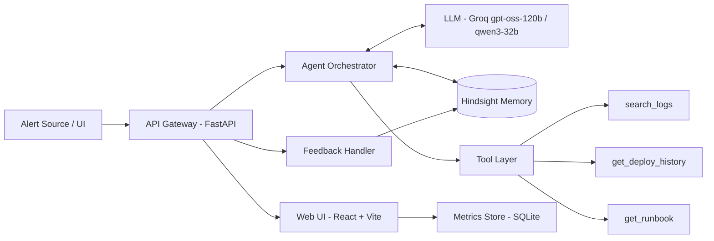

# High-Level Design (HLD)
**System:** RunbookMind – AI SRE Agent
**Version:** 1.0

---

## 1. Architecture Overview

## 2. Components
| Component | Responsibility |
|-----------|---------------|
| **Web UI (React)** | Now/Before layout, recall trace lines, ranked fixes, feedback buttons, learning curve, memory on/off toggle. Calls the FastAPI endpoints; see 5_UI_Design_Spec.md |
| **API Gateway (FastAPI)** | REST endpoints: `/alert`, `/feedback`, `/incidents`, `/metrics` |
| **Agent Orchestrator** | Runs the reasoning loop: recall → hypothesize → tool calls → rank → respond |
| **LLM Layer** | Function calling, reasoning, summarization; retry and repair on tool-call errors |
| **Hindsight Memory** | Persistent incident memory (retain, recall, reflect) |
| **Tool Layer** | Simulated log search, deploy history, runbook lookup over synthetic data |
| **Feedback Handler** | Converts engineer outcome into structured memory updates |
| **Metrics Store** | Per-incident accuracy for the learning curve chart |

## 3. Data Flow
**A. New incident**
1. Alert arrives at `/alert`
2. Orchestrator queries Hindsight: `recall(alert summary)`
3. LLM combines recalled incidents + tool results (logs, deploys)
4. Output: hypotheses + ranked fixes + evidence citations
5. UI renders response and memory panel

**B. Learning loop**
1. Engineer tries a fix, submits feedback
2. Feedback Handler builds a structured resolution record
3. Record is `retain`ed in Hindsight
4. Metrics store logs whether top-1 suggestion was correct
5. Periodic `reflect` generates cross-incident insights

## 4. Memory Design (core of the project)
| Memory Type | Content | Purpose |
|-------------|---------|---------|
| Incident record | Symptoms, service, error signature, timeline | Similarity recall |
| Resolution record | Root cause, fix steps, outcome (worked/failed), time to fix | Ranked recommendations |
| Feedback signal | Engineer verdict + notes | Outcome-weighted learning |
| Reflected insights | Patterns (e.g., "cache issues follow deploys") | Proactive suggestions |

**Bank strategy:** one memory bank per team/environment, with tags for `service`, `severity`, `error_type`, `outcome`.

## 5. Technology Stack
| Layer | Choice |
|-------|--------|
| Language | Python 3.11 |
| Backend | FastAPI |
| LLM | Groq: `openai/gpt-oss-120b` (primary), `qwen/qwen3-32b` (fallback) |
| Memory | Hindsight (Cloud or OSS) |
| UI | React + Vite + TypeScript, Tailwind (custom tokens), Radix UI primitives, custom SVG (see 5_UI_Design_Spec.md) |
| Storage | SQLite for metrics and synthetic data |
| Packaging | Docker Compose |

## 6. Key Design Decisions
- **Human-in-the-loop:** agent recommends, engineer executes
- **Memory on/off switch:** same agent, memory calls disabled, for a clean before/after demo
- **Structured retain format:** consistent fields improve recall quality
- **Outcome-weighted ranking:** fixes with more successful outcomes rank higher

## 7. Reliability & Error Handling
- Tool-call failures: validate JSON, repair once, retry with fallback model
- Hindsight timeout: continue without memory and flag in the UI
- Empty recall: agent states "no similar incident found" instead of guessing

## 8. Security & Privacy
- API keys via environment variables
- Synthetic data only; redact secrets and PII from logs before retain
- No autonomous production actions

## 9. Deployment
Local Docker Compose for the demo (API, React UI served by Vite/nginx, SQLite) connecting to Hindsight Cloud. Optional self-hosted Hindsight container.

## 10. Scalability Notes (future)
Real integrations (PagerDuty, Datadog, Slack), multi-team banks, autonomous remediation with approval gates.
